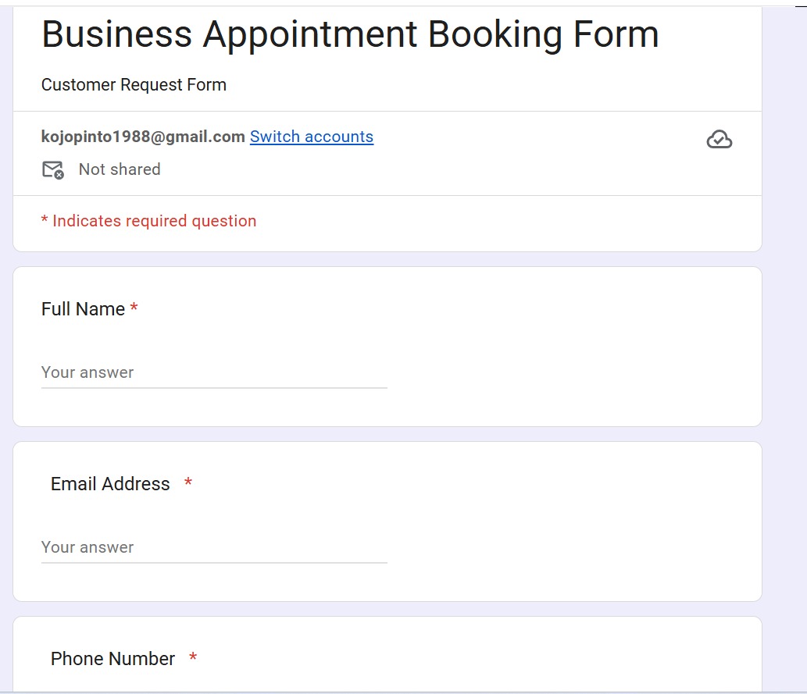
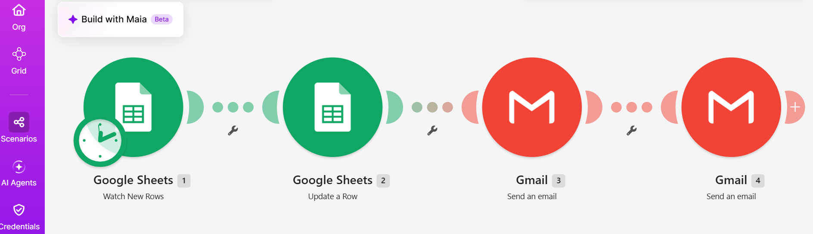
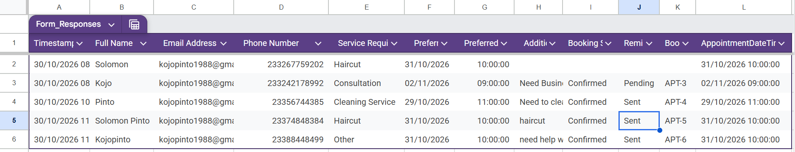
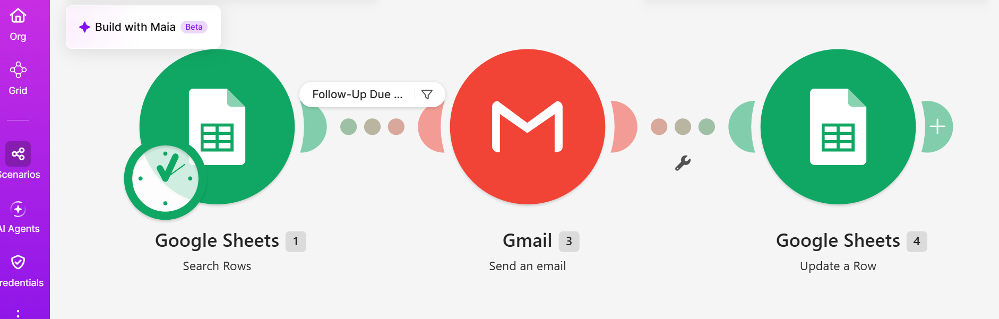
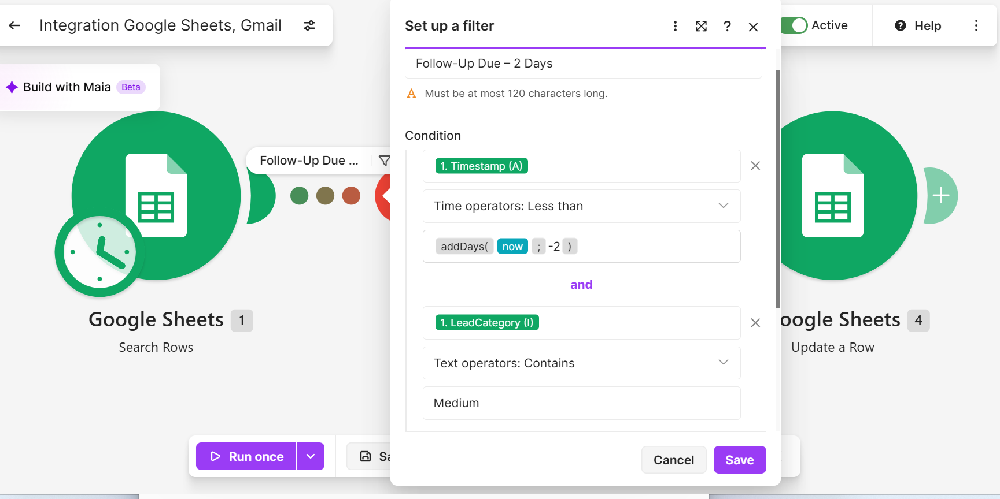
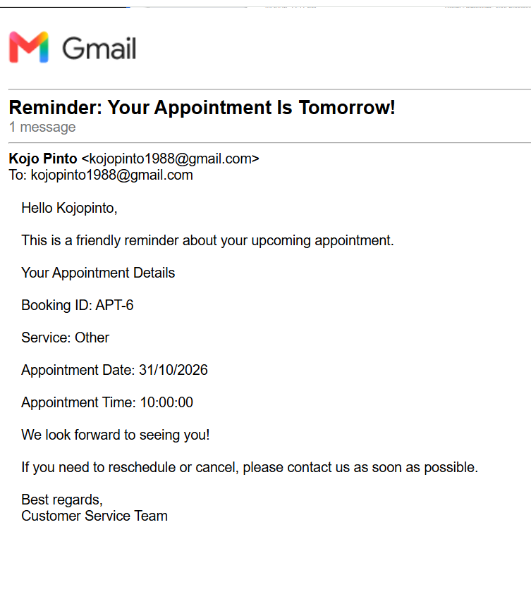

# Appointment Booking & Automated Reminder System

## Project Overview

An automated appointment management solution built using Make.com, Google Forms, Google Sheets, and Gmail.

The system streamlines the appointment booking process by collecting customer requests, generating unique booking IDs, sending confirmation emails, notifying business owners, and delivering automated appointment reminders.

This project demonstrates how no-code workflow automation can help businesses reduce manual administrative work and improve customer communication.

## Business Problem

Businesses that manage appointments manually often face challenges such as:

- Missed or forgotten appointments.
- Delayed booking confirmations.
- Repetitive administrative tasks.
- Disorganized customer booking records.
- Inconsistent customer communication.

This project addresses these challenges through two connected automation workflows.

## Key Features

- Automated appointment request collection through Google Forms.
- Automatic booking confirmation emails.
- Unique appointment ID generation.
- Instant business owner email notifications.
- Centralized appointment tracking using Google Sheets.
- Automated reminders approximately one day before appointments.
- Reminder status tracking to help prevent duplicate notifications.

## Technology Stack

| Technology | Purpose |
|---|---|
| Make.com | Workflow automation and scenario management |
| Google Forms | Customer appointment request collection |
| Google Sheets | Booking database and appointment tracking |
| Gmail | Customer confirmations, owner notifications, and reminders |

## Workflow Architecture

### Scenario 1: Appointment Booking Confirmation

**Workflow:**

Google Forms → Google Sheets (Watch New Rows) → Update Booking Record → Generate Booking ID → Customer Confirmation Email → Business Owner Notification

**Process:**

1. A customer submits an appointment request through Google Forms.
2. Make.com detects the new response in Google Sheets.
3. The booking record is updated with a Confirmed status and Pending reminder status.
4. A unique appointment ID is generated.
5. A confirmation email is sent to the customer.
6. The business owner receives a notification containing the booking details.

### Scenario 2: Automated Appointment Reminders

**Workflow:**

Google Sheets (Search Rows) → Appointment Date/Time Filter → Gmail Reminder → Update Reminder Status

**Process:**

1. The scenario checks the booking spreadsheet hourly.
2. It identifies confirmed appointments with a Pending reminder status.
3. It checks whether the appointment is between 22 and 24 hours away.
4. Eligible customers receive an automated reminder email.
5. The reminder status is updated to Sent to help prevent duplicate reminders.

## Booking Data Structure

The Google Sheets database maintains:

- Customer name and contact information.
- Service required.
- Preferred appointment date and time.
- Booking status.
- Reminder status.
- Unique appointment ID.
- Combined appointment date and time for reminder calculations.

## Business Benefits

- Reduces repetitive appointment management tasks.
- Improves the speed and consistency of customer communication.
- Helps reduce forgotten appointments through automated reminders.
- Provides a centralized record of customer bookings.
- Reduces manual follow-up work for business owners.
- Creates a more organized appointment management process.

## Project Status

**Completed and activated.**

Both automation scenarios have been configured for automatic execution and tested successfully.

## Screenshots

### 1. Appointment Booking Form

### 2. Appointment Booking Workflow

### 3. Appointment Tracking Spreadsheet

### 4. Reminder Workflow

### 5. Reminder Filter Configuration

### 6. Appointment Reminder Email

## Future Enhancements

- Google Calendar integration.
- Appointment availability checking and conflict detection.
- Appointment cancellation and rescheduling workflows.
- AI-powered customer inquiry handling.
- Automated business performance and booking reports.

## Current Limitations

- Appointment availability is not checked against a calendar.
- Scheduling conflicts are not automatically detected.
- Cancellation and rescheduling are not yet automated.
- Email delivery depends on successful scenario execution and Gmail availability.

## Author

**Solomon Pinto**

Data Analytics | IT Support | Business Process Automation | AI Automation

[GitHub Profile](https://github.com/KOJOPINTO)

## Screenshots

### 1. Appointment Booking Form

### 2. Appointment Booking Workflow

### 3. Appointment Tracking Spreadsheet

### 4. Reminder Workflow

### 5. Reminder Filter Configuration

### 6. Appointment Reminder Email

## Future Enhancements

- Google Calendar integration.
- Appointment availability and conflict checking.
- Appointment cancellation and rescheduling.
- AI-powered customer inquiry handling.
- Automated business performance reports.

## Author

Solomon Pinto

**Focus Areas:** Data Analytics | IT Support | Business Process Automation | AI Automation
